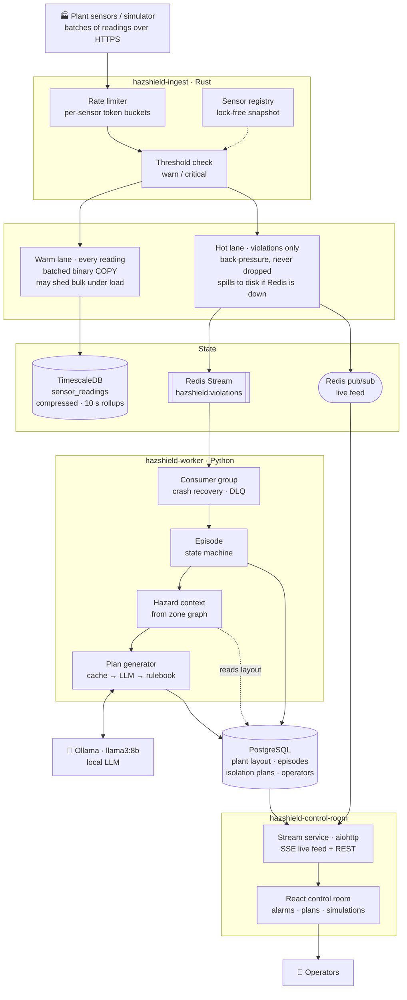
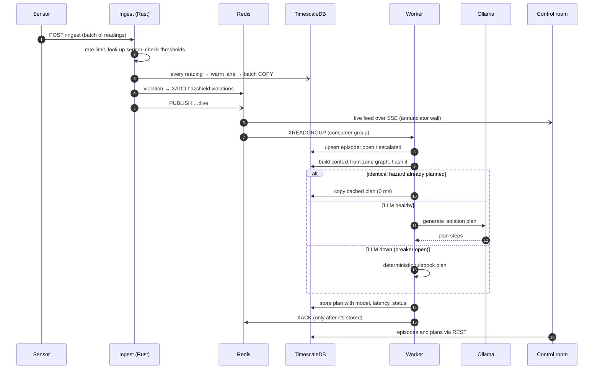
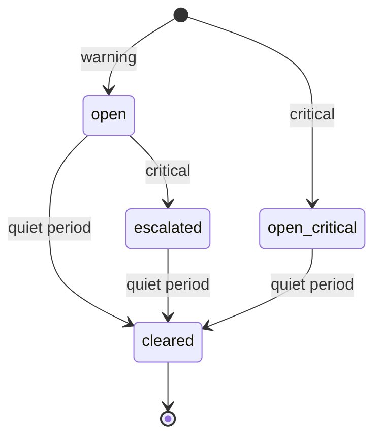

# HazShield AI

**Real-time hazard monitoring for mineral processing plants.** HazShield takes in thousands
of sensor readings a second, spots dangerous readings (methane, carbon monoxide, oxygen, temperature, pressure, airflow,
dust, vibration, seismic), groups
them into incidents, and writes an isolation plan for each one: which areas to close off and
which equipment to shut down, taking the plant's layout into account. Operators watch it all
live in a control room.

**Live control room:** [app.sumitgautam.tech](https://app.sumitgautam.tech)  ·  run a
simulated gas plume and watch alarms, incidents and plans appear.

Built as a self-hosted platform on a home-lab OpenStack cloud: Rust for the high-rate
ingest path, Python for the alarm workers, a local LLM (Ollama) for plan writing,
PostgreSQL + TimescaleDB and Redis for state, and React for the control room.

---

## How it works

### Data flow

1. **Ingest.** Sensors post batches of readings to the Rust gateway. Each reading is checked
   against its sensor's thresholds and split into two lanes:
   - **Warm lane, all readings:** batched and written to TimescaleDB with binary `COPY`.
     Under pressure this lane may shed bulk data, and says so.
   - **Hot lane, violations only:** written to a Redis Stream and never dropped. If Redis is
     down, they spill to a local file and are replayed in order when it's back.
2. **Episodes.** Python workers read the stream through a consumer group (at-least-once,
   with a dead-letter queue for bad messages) and fold thousands of violations into a few
   **episodes**, one per sensor incident: open → escalated → cleared. The database enforces
   at most one live episode per sensor, so any number of workers can run safely.
3. **Plans.** For each episode a worker builds a hazard context from the plant's layout
   (zone, neighbouring zones, assets and isolation points) and produces an **isolation plan**:
   - from the **cache** if an identical hazard already has a plan (most plans come from here),
   - otherwise from the **local LLM** (Ollama, `llama3:8b`),
   - or from a deterministic **rulebook** when the LLM is down (circuit breaker).
4. **Control room.** The stream service relays live violations over Server-Sent Events and
   serves the plant layout, episodes, plans and stats to the React UI. Anyone can watch;
   operator sign-in (server-side sessions in Redis) is in place for the actions being added
   next, such as acknowledging alarms.
5. **Observability.** Prometheus metrics, OpenTelemetry traces that follow one violation
   from stream to plan, a Grafana dashboard, and scripted chaos drills that break things on
   purpose (worker crash, LLM down, Redis blip, poison messages).

### One alarm, end to end

### Episode lifecycle

Thousands of violations from one sensor fold into **one** episode. The database enforces
at most one live episode per sensor, so several workers, retries and restarts can't
create duplicates.

### What runs where

```mermaid
flowchart TB
    NET(("🌐 Internet"))
    TUN["Cloudflare Tunnel<br/>app · stream · ingest · telemetry"]
    NET --> TUN

    subgraph HL["Home-lab OpenStack"]
        direction LR
        subgraph EDGE["edge VM<br/>2 vCPU · 2 GB"]
            direction TB
            CADDY["Caddy<br/>routing · CORS · limits"]
            ING["hazshield-ingest"]
            STR["control-room<br/>stream service + UI"]
        end
        subgraph STATE["state VM<br/>4 vCPU · 6 GB"]
            direction TB
            RD[("Redis")]
            PG[("PostgreSQL 16<br/>+ TimescaleDB")]
            OBS["Prometheus · OTel<br/>Grafana"]
        end
        subgraph COMP["compute VM<br/>4 vCPU · 10 GB"]
            direction TB
            WK["hazshield-worker"]
            OL["Ollama<br/>llama3:8b"]
        end
    end

    TUN --> CADDY
    CADDY --> ING & STR
    CADDY -->|telemetry| OBS
    ING -->|violations| RD
    ING -->|readings| PG
    STR --> RD & PG
    RD -->|stream| WK
    WK -->|episodes · plans| PG
    WK <--> OL
    OBS -.->|scrape| ING & WK
```

| Layer | Set up by |
|---|---|
| VMs, private network, security groups, VM sizes | **hazshield-infra** (Terraform + cloud-init) |
| Cloudflare Tunnel and Caddy routing | **hazshield-infra** (`edge/`) |
| PostgreSQL + TimescaleDB, Redis, database schema | **hazshield-ansible** |
| Prometheus, OpenTelemetry collector, Grafana | **hazshield-observability** |
| Services | each service repo's deploy script and systemd unit |

From the internet, only the edge VM is reachable, and only through the Cloudflare Tunnel (no
open ports). The state and compute VMs sit on a private network whose security groups allow
just the connections above; SSH goes through the edge VM as a bastion.

## The repositories

| Repository | What it is | Built with |
|---|---|---|
| [**hazshield-infra**](https://github.com/SumitGA/hazshield-infra) | The cloud: network, firewall rules, VM sizes and the three VMs (edge, state, compute) on OpenStack; Cloudflare Tunnel and Caddy routing for the public hostnames. | Terraform, cloud-init, Cloudflare Tunnel, Caddy |
| [**hazshield-ansible**](https://github.com/SumitGA/hazshield-ansible) | Configures the state VM (PostgreSQL 16 + TimescaleDB, Redis) and holds the database schema: plant layout, sensor time series with compression and retention, alarms, plans, operators. | Ansible, SQL migrations |
| [**hazshield-ingest**](https://github.com/SumitGA/hazshield-ingest) | The ingest gateway: validates and rate-limits sensor batches, detects threshold violations, and runs the warm and hot lanes. Includes the load simulator. | Rust (axum, tokio), Python simulator |
| [**hazshield-worker**](https://github.com/SumitGA/hazshield-worker) | The alarm workers: stream consumer, episode state machine, hazard context builder and plan generator (cache → LLM → rulebook), with a model bake-off tool. | Python (asyncio, asyncpg, redis), Ollama |
| [**hazshield-control-room**](https://github.com/SumitGA/hazshield-control-room) | The operator UI and its backend: live violation feed, plant topology, episodes, plans, a simulation launcher and operator sign-in. | React + Vite, Python (aiohttp), SSE |
| [**hazshield-observability**](https://github.com/SumitGA/hazshield-observability) | Metrics, traces and dashboards for the workers, plus chaos drills that prove the system recovers. | Prometheus, OpenTelemetry, Grafana, Bash |

**Suggested reading order:** infra → ansible → ingest → worker → control-room →
observability, the order the system was built in.

## Design principles

- **Never lose an alarm.** Violations get their own lane with back-pressure, a durable stream
  and a local spill file. Bulk readings can be shed under load; alarms can't.
- **The database is the referee.** Workers hold no state of their own. Atomic upserts, unique
  indexes and `SKIP LOCKED` make concurrent workers and restarts safe.
- **At-least-once, made safe.** Every step can see the same message twice without harm,
  so crashes are recoverable instead of dangerous.
- **The LLM is optional.** Plans come from the cache first and the rulebook as a fallback, so
  the system keeps producing plans when the model is slow or down.
- **Prove it under failure.** Each phase ends with a checkpoint run: load plus a deliberate
  outage, then an audit that every alarm is accounted for.

## Status

A working portfolio and learning project, built in phases: infrastructure, ingest, alarm
workers, control room, observability, then operator sign-in. It runs on a single home-lab
server and uses simulated sensors, not a real plant.

## Author

Sumit Gautam · [github.com/SumitGA](https://github.com/SumitGA)
