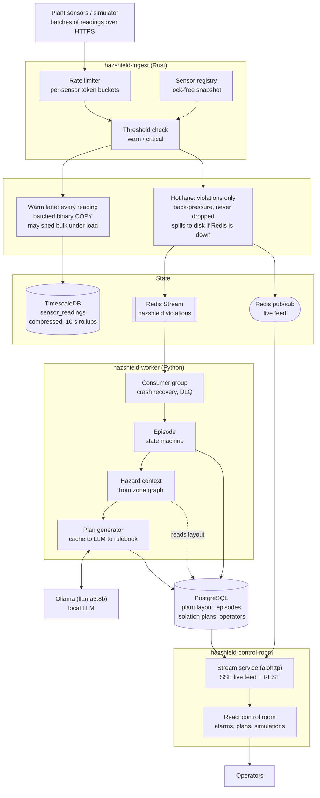
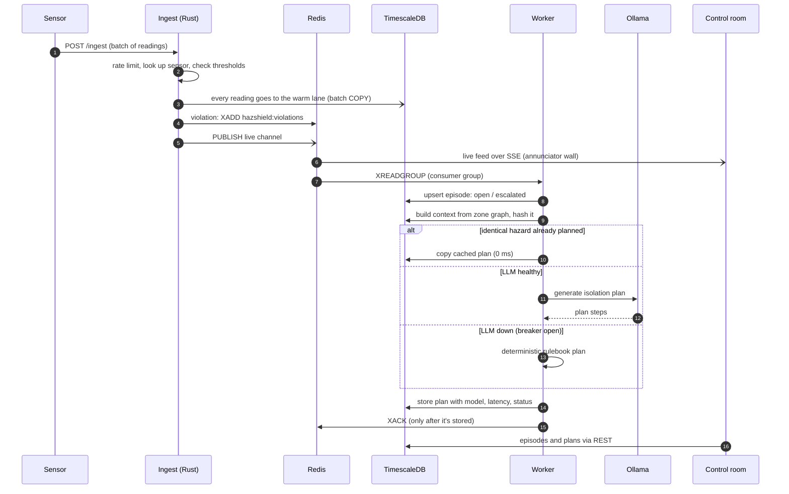
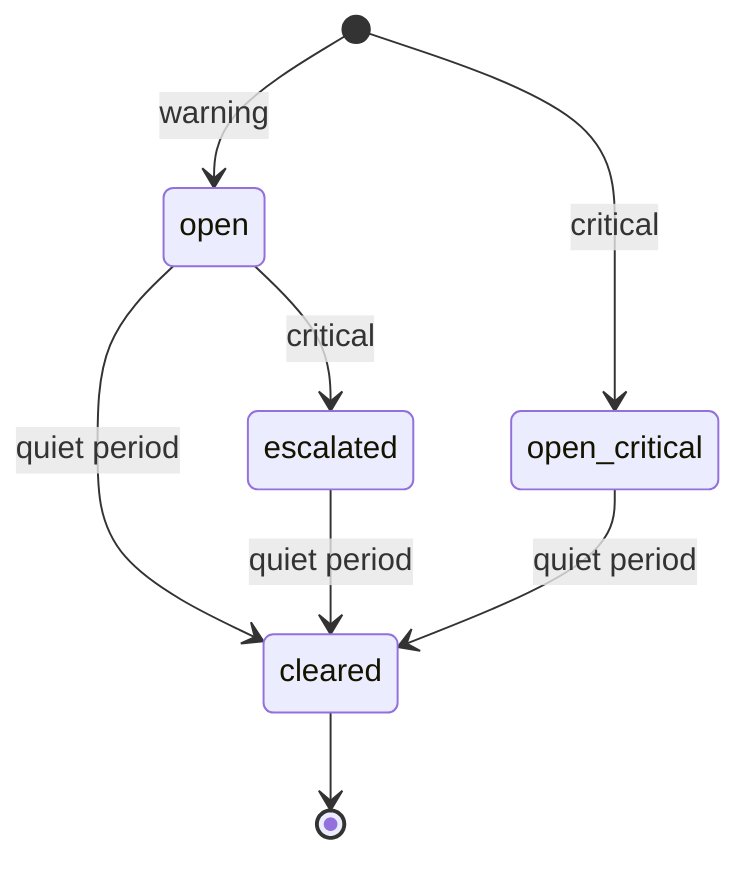
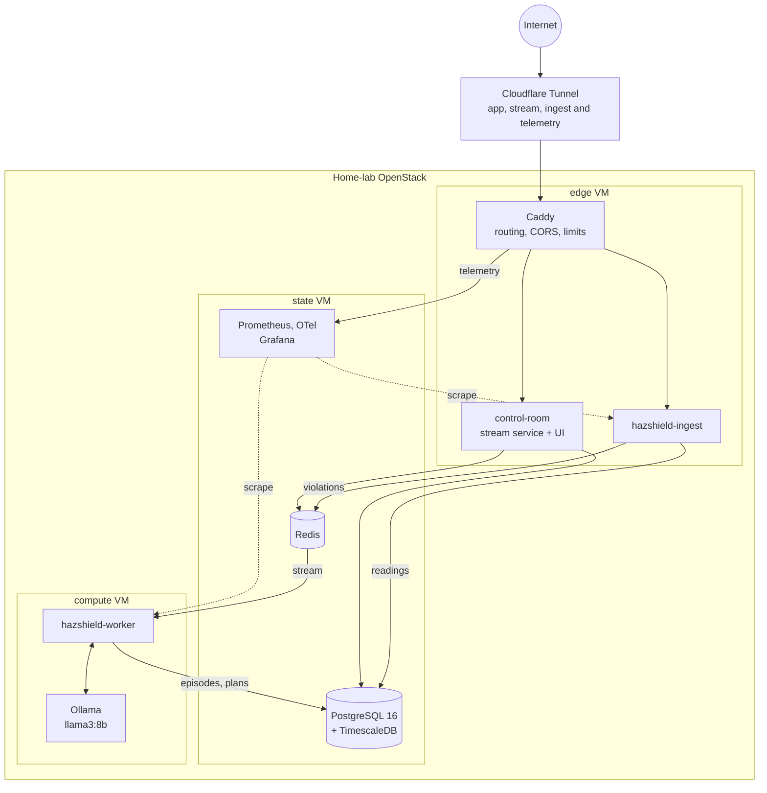

# HazShield AI

HazShield AI is a real-time hazard monitoring system for mineral processing plants that I've
been building on my home lab. It takes in thousands of sensor readings a second (methane,
carbon monoxide, oxygen, temperature, pressure, airflow, dust, vibration and seismic),
picks out the dangerous ones, groups them into incidents and writes an isolation plan for
each incident: which areas to close off and which equipment to shut down, based on how the
plant is laid out. Operators follow all of it live in a control room.

You can try the control room at [app.sumitgautam.tech](https://app.sumitgautam.tech). Start
a simulated gas plume and watch the alarms, incidents and plans come in.

The ingest path is written in Rust, the alarm workers in Python, plans are written by a
local LLM running in Ollama, state lives in PostgreSQL with TimescaleDB and in Redis, and
the control room is React. Everything runs on three VMs in my own OpenStack cloud.

This repo is the starting point: it explains how the pieces fit together and links to the
six repositories that make up the system.

## Tech stack

| Area | What I used |
|---|---|
| Ingest gateway | Rust (2021 edition), axum 0.8, tokio, sqlx, redis-rs, arc-swap, dashmap, tracing, prometheus |
| Alarm workers | Python 3 with asyncio, asyncpg, redis-py, aiohttp, prometheus-client, OpenTelemetry SDK |
| Plan writing | Ollama running `llama3:8b` locally (`phi3:mini` compared in the bake-off) |
| Control room | React 18, Vite 5, Recharts; backend in Python with aiohttp, Server-Sent Events, bcrypt |
| Databases | PostgreSQL 16 with TimescaleDB (hypertables, compression, continuous aggregates), Redis (Streams, consumer groups, pub/sub) |
| Infrastructure | OpenStack (Kolla-Ansible) on my home-lab server, Terraform 1.7+ with the OpenStack provider, cloud-init, Ubuntu 24.04 |
| Configuration | Ansible with the `community.postgresql` collection, SQL migrations, systemd units |
| Networking | Cloudflare Tunnel, Caddy 2, OpenStack security groups |
| Monitoring | Prometheus, node exporter, OpenTelemetry collector, Grafana 11 |
| Testing | a Python load simulator (10,000 readings a second) and scripted chaos drills in Bash |

## How it works

Ingest. Sensors post batches of readings to the Rust gateway, which checks each reading
against that sensor's thresholds. Every reading goes down the warm lane, where it's batched
and written to TimescaleDB with binary `COPY`; under heavy load this lane is allowed to
drop bulk readings, and it reports when it does. Readings that break a threshold also go
down the hot lane into a Redis Stream, and those are never dropped. If Redis is down they
spill to a file on disk and get replayed in order once it's back.

Episodes. The Python workers read the stream through a Redis consumer group, so every
violation is processed at least once, and anything that keeps failing ends up in a
dead-letter queue instead of blocking the rest. Thousands of violations from one sensor fold
into a single episode that goes from open to escalated to cleared. The database only allows
one live episode per sensor, so I can run as many workers as I want.

Plans. For each episode a worker describes the hazard using the plant's layout: the
zone, the zones next to it, and the assets and isolation points nearby. If an identical
hazard already has a plan, it reuses that one, which is where most plans come from. If not,
it asks the local LLM (`llama3:8b`). If the LLM is down, a circuit breaker switches to a
simple rulebook so there's always a plan.

Control room. A small Python service relays the live violations to the browser over
Server-Sent Events and serves the plant layout, episodes, plans and stats to the React UI.
Anyone can watch; operator sign-in is in place for the actions I'm adding next, such as
acknowledging alarms.

Observability. Prometheus metrics, OpenTelemetry traces that follow a single violation
from the stream to its plan, a Grafana dashboard, and chaos drills where I break things on
purpose (kill a worker, stop the LLM, interrupt Redis, send poison messages) to check that
the system recovers.

### One alarm, end to end

### Episode lifecycle

Repeated violations from the same sensor don't create new incidents; they update the open
episode. Because the database enforces one live episode per sensor, retries, restarts and
several workers running at once can't create duplicates.

### What runs where

| Part | Set up by |
|---|---|
| VMs, private network, security groups and VM sizes | hazshield-infra (Terraform and cloud-init) |
| Cloudflare Tunnel and Caddy routing | hazshield-infra (`edge/`) |
| PostgreSQL with TimescaleDB, Redis and the database schema | hazshield-ansible |
| Prometheus, the OpenTelemetry collector and Grafana | hazshield-observability |
| The services themselves | each repo's deploy script and systemd unit |

The VMs are deliberately small, because they share one home-lab server: the edge VM has
2 vCPUs and 2 GB of RAM, the state VM 4 vCPUs and 6 GB, and the compute VM 4 vCPUs and
10 GB, most of which goes to the LLM.

From the internet, the only way in is the Cloudflare Tunnel to the edge VM; there are no
open ports. The state and compute VMs are on a private network, their security groups only
allow the connections shown above, and SSH goes through the edge VM.

## The repositories

| Repository | What it does | Built with |
|---|---|---|
| [hazshield-infra](https://github.com/SumitGA/hazshield-infra) | The OpenStack network, security groups and the three VMs, plus the Cloudflare Tunnel and Caddy routing for the public hostnames | Terraform, cloud-init, Cloudflare Tunnel, Caddy |
| [hazshield-ansible](https://github.com/SumitGA/hazshield-ansible) | Sets up PostgreSQL 16 with TimescaleDB and Redis, and holds the database schema: plant layout, sensor time series, alarms, plans and operators | Ansible, SQL |
| [hazshield-ingest](https://github.com/SumitGA/hazshield-ingest) | The ingest gateway: rate limiting, threshold checks and the warm and hot lanes, plus the load simulator | Rust (axum, tokio), Python |
| [hazshield-worker](https://github.com/SumitGA/hazshield-worker) | The alarm workers: stream consumer, episode state machine, hazard context and plan generation, and a tool to compare LLMs | Python (asyncio, asyncpg), Ollama |
| [hazshield-control-room](https://github.com/SumitGA/hazshield-control-room) | The operator UI and its backend: live alarm feed, plant layout, episodes, plans, simulations and sign-in | React, Vite, Python (aiohttp) |
| [hazshield-observability](https://github.com/SumitGA/hazshield-observability) | Metrics, traces and dashboards, and the chaos drills | Prometheus, OpenTelemetry, Grafana |

If you want to read the code, the order I built it in works well: infra, ansible, ingest,
worker, control-room, then observability.

## What I cared about

Not losing an alarm. Violations have their own lane with back-pressure, a durable stream
and a spill file on disk. Bulk readings can be dropped under load; alarms can't.

Letting the database settle conflicts. The workers keep no state of their own. Atomic
upserts, unique indexes and `SKIP LOCKED` mean several workers can run at once and any of
them can restart without cleanup.

Handling duplicates instead of hoping they don't happen. Every step can see the same
message twice without harm, so a crash means a retry, not a corrupted incident.

Not depending on the LLM. Plans come from the cache first and fall back to the rulebook,
so the system keeps producing plans when the model is slow or down.

Testing under failure. Each phase ended with a run under load with a deliberate outage
(for example, stopping PostgreSQL in the middle), followed by a check that every alarm was
accounted for.

## Status

This is a personal project I use to learn and to show how I build systems. It runs on a
single home-lab server and uses simulated sensors rather than a real plant. I built it in
phases: infrastructure, ingest, alarm workers, control room, observability and then
operator sign-in. Next up are operator actions, starting with acknowledging alarms.

Sumit Gautam, [github.com/SumitGA](https://github.com/SumitGA)
